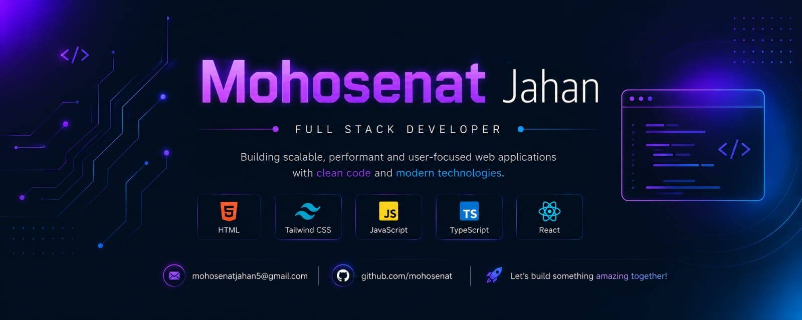

  

<h1 align="center">Hi 👋, I'm Mohosenat Jahan</h1>

  

## 👩‍💻 About Me

I’m an aspiring Full-Stack Web Developer passionate about building modern, responsive, and user-friendly web applications. I enjoy turning ideas into real-world projects and learning new technologies through hands-on practice.

Currently, I’m focused on strengthening my frontend and backend development skills and improving my problem-solving abilities to become a professional Full-Stack Developer.

## 🔭 What I'm Currently Doing

* 🌱 I’m currently learning **JavaScript, TypeScript, React.js and Node.js**
* 💻 I’m building **responsive and user-friendly web projects**
* 🚀 I’m exploring **Full-Stack Web Development**
* 📚 I’m practicing **problem-solving and programming**
* 🤖 I’m exploring the possibilities of **Artificial Intelligence**
* 🧠 I’m continuously improving my coding and development skills

---

## 🎯 My Goal

My goal is to become a **professional Full-Stack Web Developer** capable of building scalable, secure, responsive, and user-friendly applications.

I want to gain real-world development experience, work on meaningful projects, learn modern technologies, and continuously grow as a developer.

---

## 🛠️ Languages & Technologies

### 💻 Languages

  
  &nbsp;&nbsp;&nbsp;&nbsp;
  
  &nbsp;&nbsp;&nbsp;&nbsp;
  

### 🎨 Frontend

  
  &nbsp;&nbsp;&nbsp;&nbsp;
  
  &nbsp;&nbsp;&nbsp;&nbsp;
  

### ⚙️ Backend

  

### 🔧 Tools

  
  &nbsp;&nbsp;&nbsp;&nbsp;
  
  &nbsp;&nbsp;&nbsp;&nbsp;
  

---

## 🤝 Connect With Me

  
  &nbsp;&nbsp;&nbsp;&nbsp;
  

---

## 📊 GitHub Statistics

  

  

  

---

  ⭐ Thanks for visiting my profile!

  <i>Keep Learning • Keep Building • Keep Growing 🚀</i>

